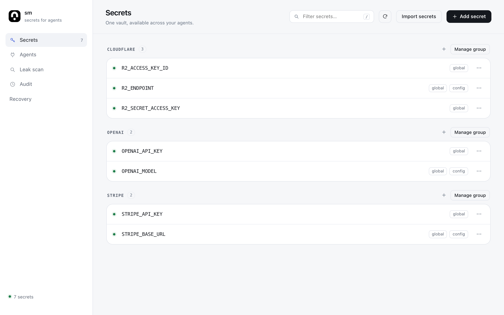
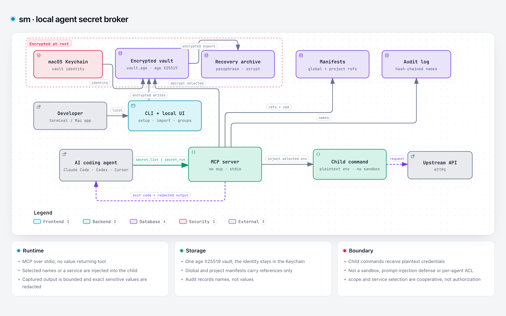

<p align="center">
  
</p>

# sm

**One local vault. Every coding harness. No secret values in model context.**

`sm` stores credentials once on your Mac and lets AI coding agents use them
without ever returning the values to the model. Agents get `secret_list` and
`secret_run`; there is deliberately no `secret_get`.

[](https://github.com/karthikmprakash/agents-secret-manager/actions/workflows/ci.yml)
[](https://github.com/karthikmprakash/agents-secret-manager/releases/latest)
[](https://karthikmprakash.github.io/agents-secret-manager/)
[](LICENSE)
[](go.mod)
[](#install)

<picture>
  <source media="(prefers-color-scheme: dark)" srcset="docs/assets/sm-secrets-dark.png">
  
</picture>

> **Status: 0.x, macOS-first.** Strong enough for daily use on your own machine;
> not a hardened sandbox, notarized app or team secrets platform. Read
> [Security boundaries](#security-boundaries) before trusting it with anything
> critical.

## The problem

Pasting an API key into an AI chat puts it in the transcript, the provider's
logs, and anything the model can be prompted to do. Per-project `.env` files
spread copies around, and every coding harness needs its own MCP wiring.

## The solution

`sm` keeps credentials in one age-encrypted local vault, exposes only
command-running MCP tools, and connects the harnesses it detects. No account, no
cloud sync, no telemetry, no model calls.

- **One vault, every folder.** Global secrets plus per-project reference
  manifests; repositories never contain values.
- **Access without exposure.** Values are injected into a child process.
  Captured output is redacted; the model only sees names and results.
- **Works with your agents.** Automatic wiring for nine harnesses, plus
  copy-paste snippets for anything else.
- **Mac-first, but local.** A CLI, a loopback-only UI, and a native WKWebView
  shell.
- **Honest boundaries.** Children receive plaintext; this is not a sandbox or a
  prompt-injection defense.

## Install

Requirements: macOS 13+, Go **1.27+**. Xcode command-line tools only for the
`.app` bundle.

```sh
git clone https://github.com/karthikmprakash/agents-secret-manager
cd agents-secret-manager

# CLI
mkdir -p ~/.local/bin
go build -o ~/.local/bin/sm ./cmd/sm

# Optional Mac app (ad-hoc signed, not notarized)
./scripts/build-mac-app.sh
open dist/sm.app
```

Then run the one-time setup:

```sh
sm onboard        # vault, secrets, detected agent wiring
sm ui             # local UI (loopback, random per-run token)
```

`sm onboard --yes` is non-interactive. `sm setup --dry-run` previews changes
without writing; `sm setup --agent claude` wires one harness.

Prebuilt binaries for tagged releases are on
[GitHub Releases](https://github.com/karthikmprakash/agents-secret-manager/releases).
The 0.x line moves quickly; build from source for the latest. There is no
Homebrew formula or signed installer yet. Moving the binary later requires
re-running `sm setup`, because harness configs store its absolute path.

## Quick start

```sh
sm add --global OPENAI_API_KEY
sm add --global STRIPE_SECRET_KEY --service stripe
sm add --global STRIPE_BASE_URL --service stripe --config
sm setup

# run locally with the group injected
sm exec --service stripe -- ./app
```

An agent asks for the action, not the credential:

```jsonc
{ "command": "curl -s https://api.stripe.com/v1/charges -u $STRIPE_SECRET_KEY:",
  "service": "stripe" }
```

New secrets are visible on the next tool call. Harness configuration changes
need a reconnect or restart.

## Agent access

Every configured harness starts the same MCP server:



Agents call the MCP server; selected values are injected into the child process
and only its output returns. Children receive plaintext — see
[Security boundaries](#security-boundaries).

| Tool | Returns |
| --- | --- |
| `secret_list` | Names, group, transport, present/missing — **never values** |
| `secret_run` | Exit code plus captured output; values are injected, not returned |

Omitting `names` and `service` injects every env-deliverable secret. That is
cooperative least privilege, not authorization. `sm` is not a sandbox.

### Supported harnesses

| Harness | Wiring |
| --- | --- |
| OpenCode | global MCP entry via its CLI |
| Claude Code | `~/.claude.json` (user scope) |
| Hermes | `~/.hermes/config.yaml` |
| Codex (OpenAI app/CLI) | `~/.codex/config.toml` |
| DeepSeek Harness | `~/.dsh/profiles/*/cordis.patch.yml` (requires the official `dsh-mcp-client` plugin) |
| Cursor | `~/.cursor/mcp.json` |
| Claude Desktop | `Claude/claude_desktop_config.json` |
| Gemini CLI | `~/.gemini/settings.json` |
| Windsurf | `~/.codeium/windsurf/mcp_config.json` |

Status reflects configuration on disk, not a verified live connection. Cloud-only
chat apps cannot reach a local vault. For manual wiring:

```sh
sm config                 # every shape
sm config --agent codex   # one harness
```

## Features

- **Local vault:** age X25519 ciphertext at `~/.config/sm/vault.age`; identity
  in the macOS Keychain, not in a file or an environment variable.
- **MCP server:** stdio, bounded output, cancellation, timeouts, and exact-value
  redaction of sensitive values.
- **Agent-safe by design:** no value-returning MCP tool.
- **Global and project manifests:** `.agentsecrets.toml` stores references only;
  `.env` can use `sm://NAME`.
- **Groups and plain config:** keep `BASE_URL` next to its `API_KEY`; mark
  non-secret configuration so it is not masked or reported as a leak.
- **Paste-anything import:** `.env`, JSON/YAML, setup commands, `curl` headers,
  labeled blocks and bare values are parsed locally for review.
- **Daily CLI:** dashboard, agent status, grouped help, shell completion, audit,
  leak scan and encrypted recovery.
- **Local UI:** review imports, manage groups, inspect agents and create recovery
  archives in a loopback-only browser UI or the Mac app.

## Import anything

The import sheet parses the text locally and proposes names, groups and
Secret/Config types. Review and edit everything before saving; existing values
are never overwritten.

```text
STRIPE_BASE_URL=https://api.stripe.com
my email address is person@example.org
Your API Token cfat_…
Access Key ID …
Secret Access Key …
S3 API endpoint https://….r2.cloudflarestorage.com
```

Cloudflare R2 exports become one `cloudflare` group. Unknown values default to
**Secret**; URLs with credentials, query parameters or fragments stay sensitive.
No model or network call is involved. See the [guide](docs/GUIDE.md#import-and-review)
for parser details and conflict handling.

## Recovery

```sh
sm backup --out sm-recovery.age
sm restore --file sm-recovery.age --verify    # authenticate, change nothing
sm restore --file sm-recovery.age             # empty destination vault only
```

Archives are passphrase-encrypted with age (scrypt) and contain the global
manifest plus all vault values. The Keychain identity is not exported; restore
re-encrypts with the destination Mac's identity. Project manifests, harness
configs and audit history are not included.

Keep the passphrase separately, verify the archive, and restore **before**
onboarding creates a vault on a new Mac. There is no password-reset service.

## Everyday commands

```sh
sm                      # dashboard and next steps
sm status               # same, explicitly
sm agents               # detected harnesses and wiring state
sm env --verbose        # declared entries and references, never values
sm log --limit 20       # recent audit entries
sm log verify           # verify the hash chain
sm doctor               # find plaintext copies of registered values
sm help add             # usage, options and examples
eval "$(sm completion zsh)"
```

Color is used only on a terminal. Set `NO_COLOR=1` or `SM_NO_COLOR=1` for plain
output. Full command and workflow details are in the [guide](docs/GUIDE.md).

## Security boundaries

- **Local only.** No account, cloud sync, telemetry, remote API or model call.
- **Encrypted at rest.** age X25519 ciphertext; the identity lives in the macOS
  Keychain. Writes are serialized, atomic and fsynced.
- **Children receive plaintext credentials.** Arbitrary code can encode,
  exfiltrate or write them to disk. This is not a sandbox, prompt-injection
  defense, per-agent ACL or egress firewall.
- **Redaction is exact-value masking of captured output.** Encoded values, raw
  TTY output and alternate channels are outside that guarantee. `--only` and
  `service` are cooperative selection, not authorization.
- **Audit is tamper-evident, not tamper-proof.** Hash links detect interior
  damage; they do not prevent same-user rewriting or truncation.
- **`sm doctor` is a bounded scanner** for registered values, not a proof that a
  transcript or repository is clean.

See [SECURITY.md](SECURITY.md) for the full model and reporting process.

## Alternatives

These are good tools; choose based on your constraints.

- **[1Password Environments MCP](https://www.1password.dev/environments/mcp-server)** —
  polished local MCP with approvals, team features and a paid account.
- **[Secretctl](https://github.com/forest6511/secretctl)** — local-first,
  single-binary MCP secrets manager with fields and bindings.
- **[Doppler](https://www.doppler.com/agents) / [Infisical](https://infisical.com/docs/documentation/platform/agent-proxy/overview) /
  [Bitwarden](https://bitwarden.com/solutions/agentic-ai-security)** — runtime
  injection plus team, cloud or self-hosted policy.
- **HashiCorp Vault / cloud secret managers** — enterprise identity, rotation
  and audit.
- **Keychain, `pass`, SOPS or dotenvx** — local storage or file injection; you
  provide the agent wiring.

`sm` is for the case where you want a Mac-first, zero-account vault that wires
many harnesses and keeps values out of the MCP surface without a subscription.

## Docs

- [Landing page](https://karthikmprakash.github.io/agents-secret-manager/) — product overview, screenshots and install.
- [Guide](docs/GUIDE.md) — commands, imports, groups, projects, recovery and limits.
- [Architecture](docs/ARCHITECTURE.md) — components, data flow and invariants.
- [Contributing](CONTRIBUTING.md) — setup, adapter checklist and style.
- [Security policy](SECURITY.md) — reporting and threat model.
- [Implementation review](docs/REVIEW.md) — fixes and remaining work.
- [Local-only roadmap](docs/LOCAL-ROADMAP.md) — proposed features and constraints.
- [Changelog](CHANGELOG.md).
- [Architecture diagram source](docs/assets/sm-architecture.json) — Archify JSON used for the README architecture diagram.

## Development

```sh
make check                 # gofmt, vet, test -race
make build                 # ~/.local/bin/sm
python3 scripts/test-ui.py # isolated Playwright flows
```

Tests use temporary vaults and generated identities; they never configure your
installed harnesses. See [CONTRIBUTING.md](CONTRIBUTING.md) for the code map and
adapter guide.

## Credits

Brand marks in the UI use [Simple Icons](https://simpleicons.org) (CC0) and a
caduceus glyph from [game-icons.net](https://game-icons.net) (CC BY 3.0). All
product names and logos are trademarks of their respective owners and are shown
only to identify the harness being configured.

## License

[MIT](LICENSE) © 2026 Karthik M Prakash
